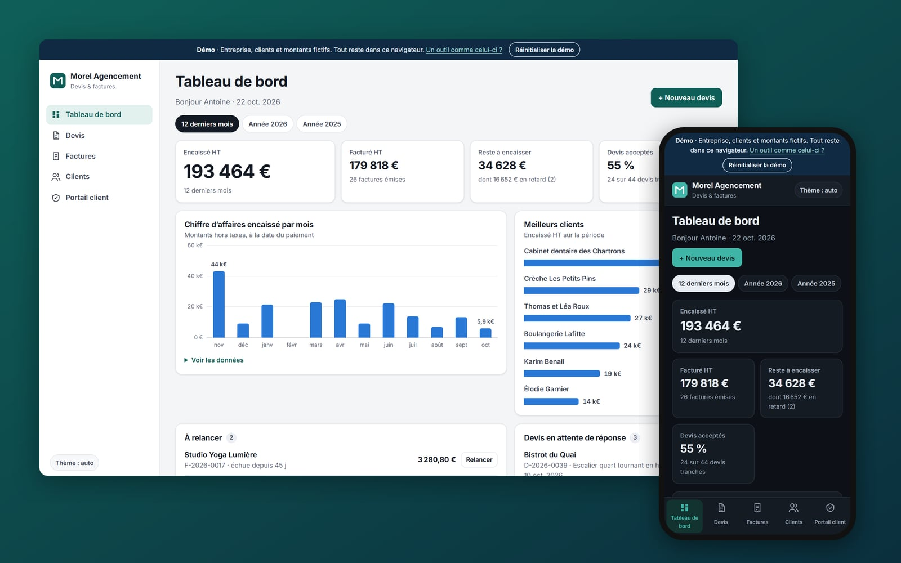
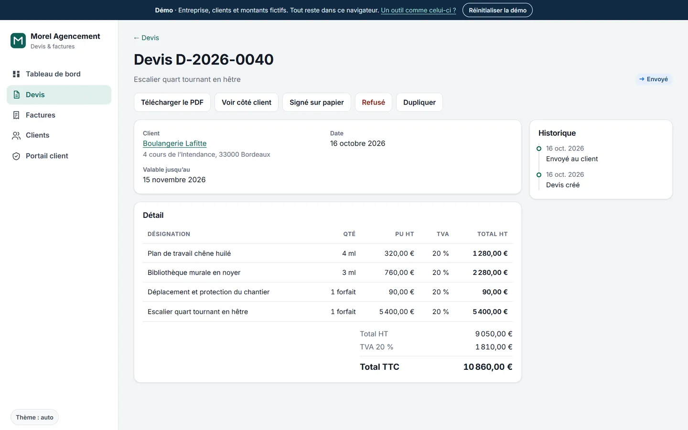
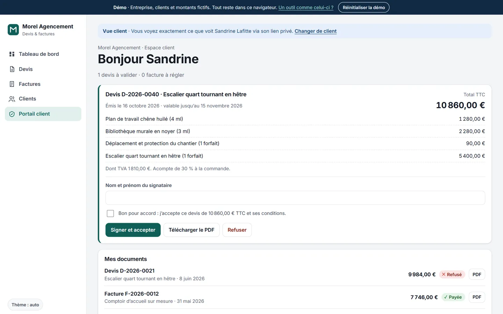
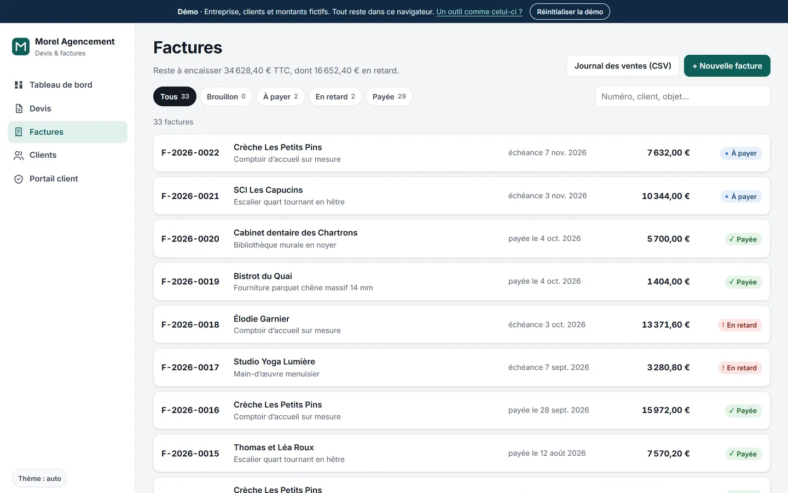
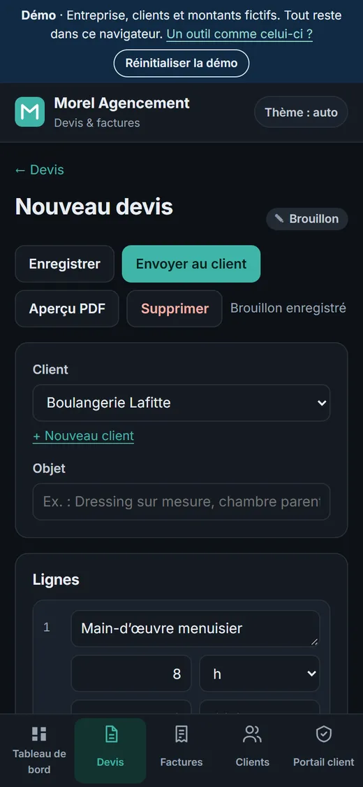

# Morel Agencement · quotes, invoices and client portal (demo)



**Live demo: https://barkatzineddine.github.io/demo-facturation/** (works on a phone, light and dark themes)

A business tool for a fictional joinery company in Bordeaux: clients, quotes turned into invoices, **PDF export generated in the browser**, payment tracking, reminders, revenue charts and a **client portal** where customers accept quotes with a timestamped e-signature. It is a portfolio piece by [Mohamed Zineddine Barkat](https://barkatzineddine.github.io/). The interface is in French; all data stays in your browser.

## Try it

1. **Devis → + Nouveau devis**: pick a client, write the subject, add lines from the catalogue, watch the totals update, then **Envoyer au client**: the quote gets its final number.
2. **Voir côté client**: you see the client portal. Sign the quote (name + "Bon pour accord").
3. Back on the quote: the acceptance proof (SHA-256 fingerprint) is shown. **Convertir en facture**, then **Émettre la facture**.
4. **Télécharger le PDF** on any quote or invoice. A sample is in [`docs/exemple-facture.pdf`](docs/exemple-facture.pdf).
5. **Enregistrer un paiement**, or pay from the portal (simulated). Late invoices have a **Relancer** button with a ready-to-send reminder.
6. **Factures → Journal des ventes (CSV)** for the accountant. **Réinitialiser la démo** in the top banner starts over.

## Features

**Dashboard**: one period filter (last 12 months, this year, last year) drives every figure below it: cash received, invoiced, still to collect (and how much is late), quote acceptance rate, revenue per month, best clients, invoices to chase, quotes awaiting an answer, recent activity.

**Quotes and invoices**
- Line editor: free lines or catalogue items, quantity, unit (u, flat rate, hour, m², linear metre), unit price excluding VAT, VAT rate per line (20 %, 10 % for renovation work in homes, 5.5 %), reorder and delete lines, live totals with VAT per rate.
- Life cycle: draft → sent → accepted / refused / expired for quotes; draft → issued → paid, with "late" computed from the due date, for invoices.
- French rules built in: sequential numbering in date order with no gaps (`F-2026-0023`), the invoice date is the issue date, an issued invoice can no longer be edited or deleted, mandatory mentions on the PDF (late payment penalties, €40 recovery fee for business clients, no discount for early payment, VAT number and SIRET).
- History on every document: created, sent, viewed by the client, accepted (by whom), converted, paid, reminders.

**PDF in the browser, no library** ([`pdf.js`](assets/js/pdf.js), [`docpdf.js`](assets/js/docpdf.js)): a small PDF 1.4 writer using the standard Helvetica fonts in WinAnsi encoding (French accents, « », €) with the real Adobe font metrics for right-aligned amounts and word wrapping. Multi-page tables repeat their header; the text stays selectable and searchable. Documents never leave the browser.

**Client portal**: each client has a private link with a random 16-character token (about 80 bits). The client sees quotes to approve, signs with their name, refuses with an optional note, downloads PDFs and pays invoices (simulated). The first view of a quote is written to its history, like a read receipt.

**Charts** built in plain HTML and CSS: one series per chart, thin bars with rounded data ends, hairline grid, value labels only on the highest and current month, tooltips on hover and on keyboard focus, and a data table behind every chart.

| Quote with acceptance proof | Client portal |
|---|---|
|  |  |

| Invoices | Line editor on a phone (dark theme) |
|---|---|
|  |  |

## Security by default

| Measure | How |
|---|---|
| Strict Content-Security-Policy | `default-src 'none'`; scripts, styles, fonts and images from this site only; `form-action 'none'`, `base-uri 'none'`, `object-src 'none'`. |
| Trusted Types | `require-trusted-types-for 'script'` with `trusted-types 'none'`. No `innerHTML`: every element is created by code and user text is always displayed as text ([`core.js`](assets/js/core.js)). |
| Local PDF generation | Quotes and invoices are generated in the browser: no document is sent to an online converter. |
| Integrity proof | An accepted quote stores a SHA-256 fingerprint of its number, lines, total, signer and time. |
| Unguessable portal links | 16 random characters from `crypto.getRandomValues`. In production: links that expire, sent by e-mail and revocable. |
| Defensive storage | All saved data is checked against a schema on load (types, lengths, dates, VAT rates, units); corrupt or hand-edited data is discarded. |
| Clean input | Invisible and bidi characters removed, length limits, checks on e-mail, French phone, postcode and SIRET. |
| CSV export | Formula injection neutralised. |
| No third party | No CDN, analytics, cookies or trackers; font served from the site. |

A production version adds server-side authentication (hashed passwords, two-factor), access control on every document, HTTP security headers, logs, encrypted backups, GDPR retention rules (accounting records: 10 years) and support for the French e-invoicing reform (Factur-X through an approved platform).

## Performance

Lighthouse on the live site (22 October 2026), mobile profile: **Performance 98, Accessibility 100, Best Practices 100, SEO 100**; desktop profile: 100 on all four. One variable font (48 KB) preloaded with `font-display: optional` so the layout never jumps, the theme is applied before the first paint, no dependency to download.

## Stack

- HTML, CSS and vanilla JavaScript (ES modules). No framework, no build step, no runtime dependency, PDF writer included.
- Font: Inter variable, self-hosted (from `@fontsource-variable/inter` 5.3.0, SIL Open Font License). Helvetica metrics for the PDF come from the Adobe Core 14 AFM files.
- Hosted on GitHub Pages.

## Run locally

```bash
python -m http.server 8000
```

Then open http://localhost:8000/.

## Project structure

```
index.html              shell (sidebar / bottom tab bar), CSP
assets/js/core.js       safe DOM builder, storage, input cleaning, helpers
assets/js/data.js       company, catalogue, demo history, totals, numbering, validation
assets/js/state.js      store, selectors, status chips
assets/js/actions.js    send, accept, convert, issue, pay, remind
assets/js/pdf.js        minimal PDF writer
assets/js/docpdf.js     quote and invoice layout
assets/js/charts.js     column chart and bar list
assets/js/dashboard.js  dashboard
assets/js/docs.js       lists, editor, document view
assets/js/clients.js    clients
assets/js/portal.js     client portal
assets/js/app.js        router, theme, security page
```

## Credits and license

- Code: [MIT](LICENSE), © 2026 Mohamed Zineddine Barkat.
- Company, clients, amounts, SIRET, VAT number and IBAN are fictional. Phone numbers come from the blocks ARCEP reserves for fiction (05 36 49 and 06 39 98); e-mail addresses use the reserved `.example` and `example.com` domains.

**Want a tool like this for your business?** [Get in touch](https://barkatzineddine.github.io/#contact).
