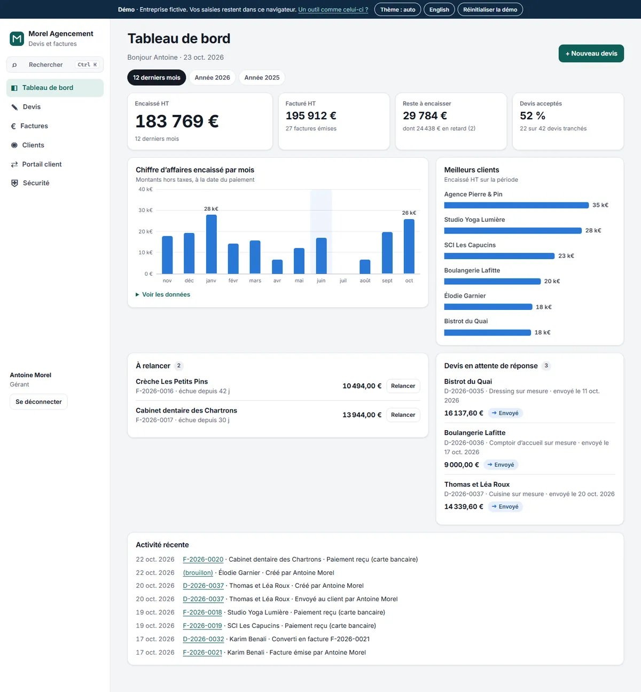
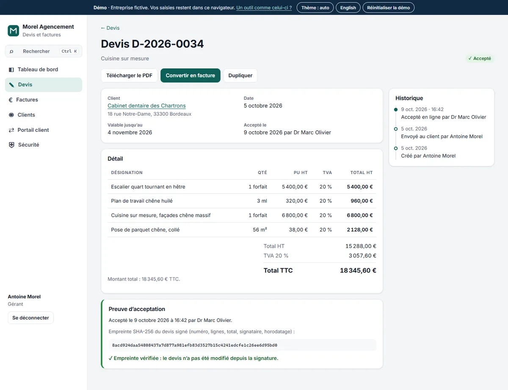
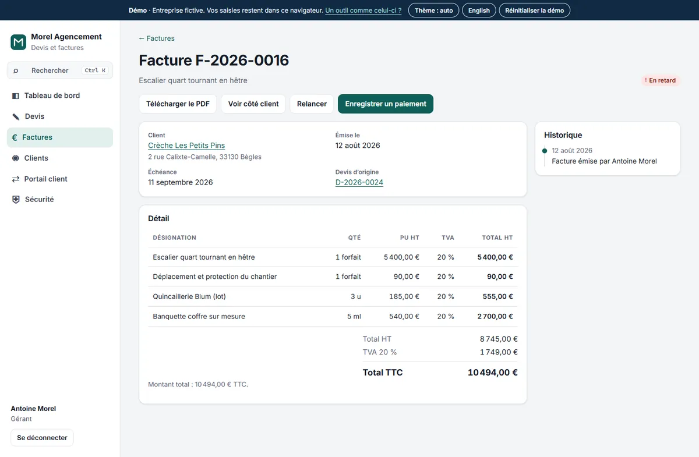
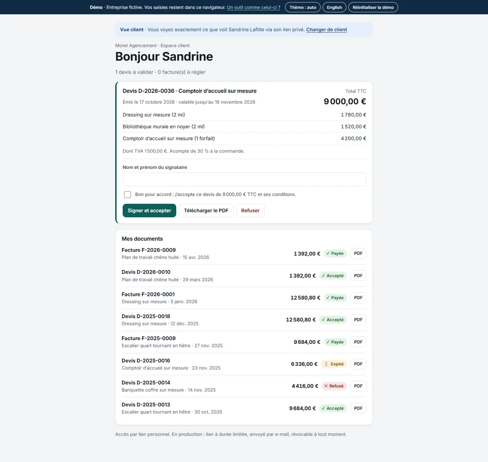
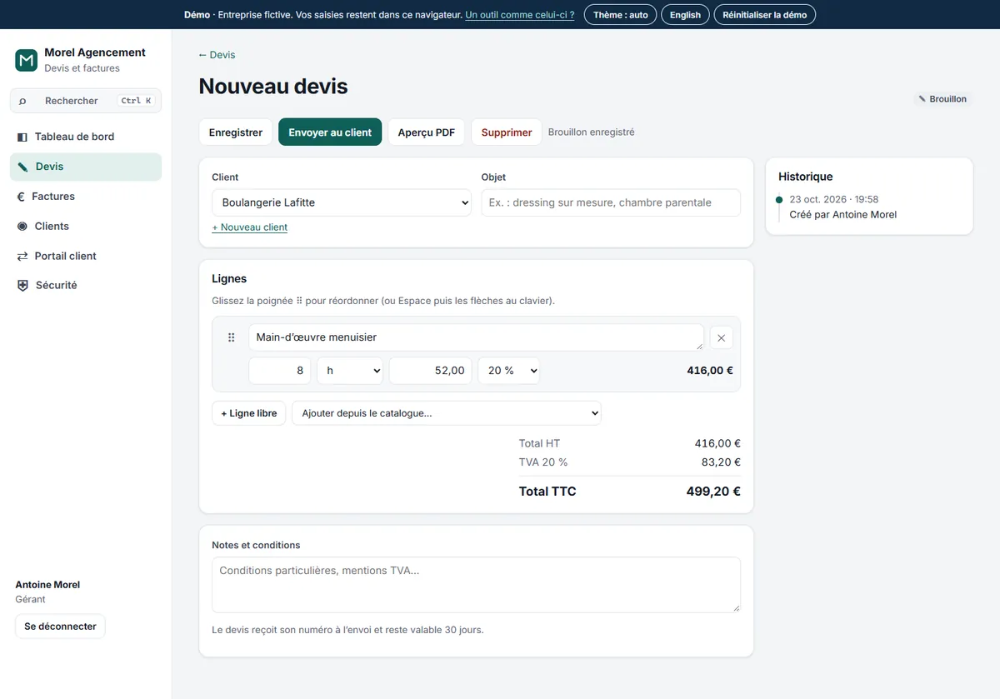
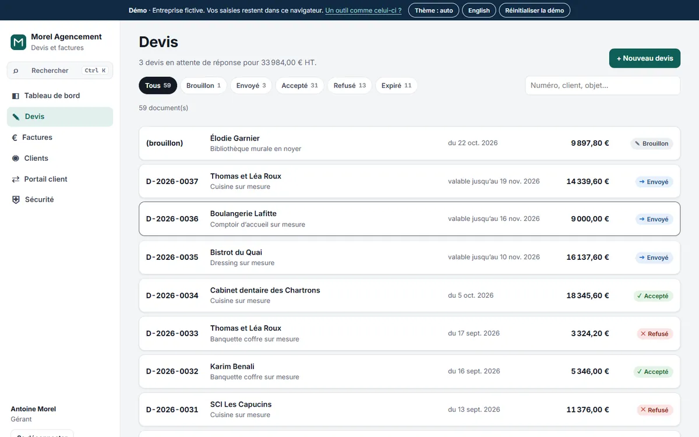
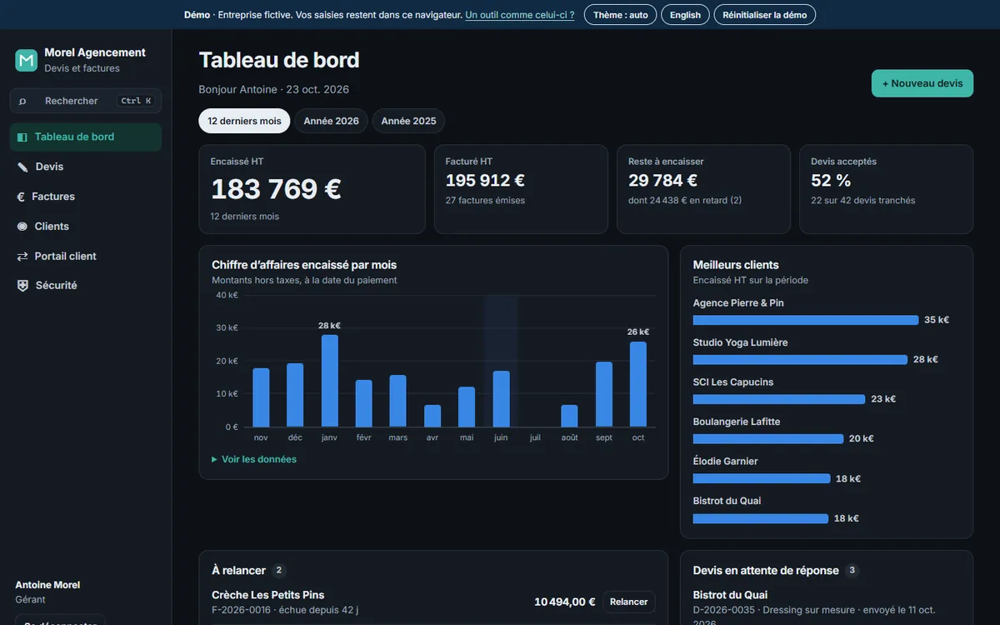
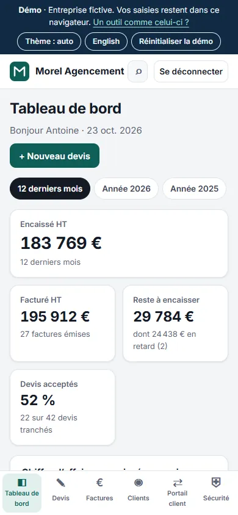
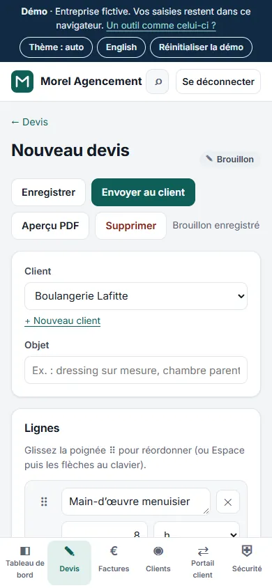
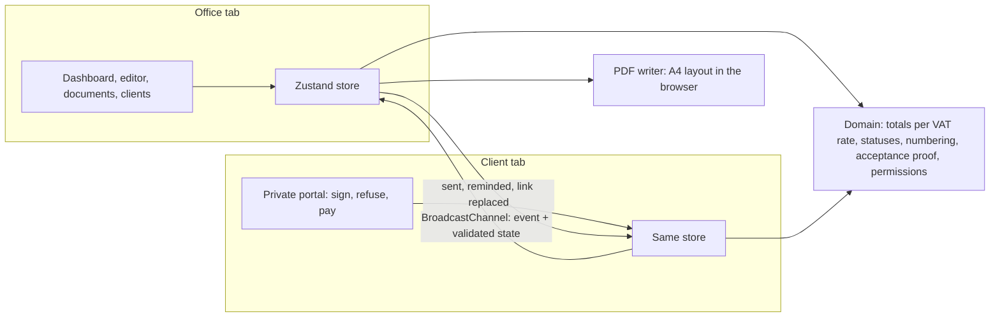

# Morel Agencement · quotes and invoices for a joinery business (demo)

[](https://github.com/Barkatzineddine/demo-facturation/actions/workflows/ci.yml)
[](https://barkatzineddine.github.io/demo-facturation/)

[](LICENSE)

A quoting and invoicing tool for a fictional joiner in Bordeaux: quotes built line by line, sent to the client, **signed online in a client portal with a verifiable SHA-256 proof**, converted to invoices that follow French invoicing rules, exported as **PDF files generated in the browser**, paid, chased. Two staff roles, a dashboard with 14 months of history, and the office tab sees each client action live. French interface with an English switch, light and dark themes, installable, works offline.

**Live: <https://barkatzineddine.github.io/demo-facturation/>** (the sign-in page lists two demo accounts: the owner and the accountant). Company, clients and amounts are fictional.



## Try it in two minutes

1. **Sign in as the owner**, click **+ New quote**, pick a client, add lines from the catalogue, drag a line to reorder it (or Space and the arrow keys), preview the PDF, then **Send to client**: the quote gets its number.
2. Open **Client portal** in a second tab and choose that client: the office tab shows "has just opened the quote". Sign it (name and "approved" box): the office is told at once and the quote shows its **acceptance proof, verified**.
3. Back in the office: **Convert to invoice**, **Issue** (date and number are set, the invoice is now frozen), **Download the PDF**, then **Record a payment**.
4. In the dashboard, **chase** a late invoice: the reminder text is ready to copy, and the reminder goes into the invoice history.
5. Sign out and sign in as the **accountant**: payments, reminders and the sales ledger export are there; creating, sending and issuing are not, even by typing the address.

## Features

**Quotes and invoices**
- Line editor with units (hour, m², linear metre, lump sum…), VAT at 20, 10 or 5.5 %, a catalogue of usual work, drag-and-drop reordering that also works with the keyboard and is announced to screen readers, unsaved-changes warning.
- Totals in integer cents with VAT per rate; quotes valid 30 days, then shown as expired; invoices due in 30 days, then shown as late.
- **French invoicing rules:** chronological numbering per year without gaps (`D-2026-0037`, `F-2026-0021`), a quote gets its number when it is sent and an invoice its number and date when it is issued, an issued invoice can be neither edited nor deleted, legal mentions on the PDF (SIRET, VAT number, late-payment penalties, the €40 recovery fee for business clients).
- **PDF generated in the browser** by a small PDF 1.4 writer written for this project (no library, no server): A4 layout, line table, VAT breakdown, conditions, signature block. The document never leaves the device. [Sample invoice (PDF, 7 KB)](docs/exemple-facture.pdf).
- History on every document (created, sent, opened, accepted, converted, issued, reminded, paid: who and when), duplicate, sales ledger export to CSV.

**Client portal and e-signature**
- Each client has a private link (a random 16-character token, about 80 bits) that the owner can replace in one click; the old link stops working at once.
- The client sees the quotes to answer, signs (name and "approved" box) or refuses with a note, downloads PDFs and pays an invoice in a simulated payment.
- **Acceptance proof:** the signed quote gets a SHA-256 fingerprint of its number, client, lines, total, signatory and time. It is recomputed every time the quote is shown, so a quote changed after signature shows as tampered (a browser test changes one price to prove it).
- The office tab is told live when a client opens, signs, refuses or pays (BroadcastChannel), with a link to the document.

**Office**
- Dashboard over the last 12 months or a calendar year: cashed and invoiced revenue, amount still to collect and how much of it is late, acceptance rate, revenue per month (with its data table), best clients, invoices to chase, quotes awaiting an answer, recent activity.
- Reminder dialog with a ready-to-copy message (amount, due date, days late) that stays editable; payment dialog (transfer, card, cheque, cash).
- Clients (companies or individuals, SIRET checked) with their documents and totals; status filters and instant search on quotes and invoices; Ctrl K searches everything.
- **Two roles**, checked in the state functions and not only hidden in the interface: the **owner** does everything, the **accountant** records payments, sends reminders and exports.

| Signed quote with its proof | Issued invoice |
| --- | --- |
|  |  |

| Client portal | Quote editor |
| --- | --- |
|  |  |

| Quotes | Dark theme |
| --- | --- |
|  |  |

| Dashboard on a phone | Editor on a phone |
| --- | --- |
|  |  |

## Engineering

**Stack:** React 19, TypeScript 6 in strict mode, Vite 8, Zustand, Zod (`zod/mini`), dnd-kit. No UI kit, no PDF or chart library, no router library (a small typed hash router fits GitHub Pages). Every dependency is pinned to an exact version.



- **Money in integer cents**, VAT computed per rate and rounded once per rate, as on a paper invoice.
- **Statuses are derived, not stored**: "expired" and "late" come from the dates when the document is read, so they are never stale.
- **Numbering as a rule, not a counter in the UI.** `nextNumber` gives the next number of the year, and `numberingProblems` checks that the numbers follow the dates without gaps; the seed data goes through it in the tests.
- **Permissions in the domain.** `sendQuote`, `issueInvoice`, `recordPayment`, `saveClient` take the staff account and refuse what its role does not allow; the interface only reflects it.
- **Everything persisted is validated.** Storage and cross-tab messages go through the same Zod schemas; tampered or corrupt data is rejected as a whole and the seed takes over.
- **Light first load.** The shell and the dashboard come first; documents, editor, portal and clients load on demand, and a build-time service worker precaches them for offline use.
- **Pre-rendered first screen.** After the build, `build/prerender.ts` opens the built app in headless Chrome with empty storage and copies the rendered sign-in page into `index.html`, so a first visit sees it before any JavaScript arrives. The copy is inert, and the app replaces it on its first render without replaying entrance animations; the app's code downloads with the page (`modulepreload`) but runs only after that first paint. A tiny inline script, allowed by its CSP hash, shows the copy only on a first visit: a deep link, saved data or another language never flash the wrong screen. On a simulated mobile 4G line, the sign-in page now appears after 0.64 s instead of 1.30 s.

```
src/
  domain/   catalogue and company, schemas, rules (dates, totals, statuses, numbering, proof payload), seed data
  state/    the store and every action (drafts, sending, signature, invoices, payments, reminders, clients), staff session
  pdf/      writer.ts (PDF 1.4: fonts, text, shapes) and layout.ts (quote and invoice pages)
  shared/   router, i18n, security helpers, anti-spam, persisted store, service worker, UI primitives
  ui/       status chip, line and total tables, history, charts
  pages/    Dashboard, DocList, DocPage (view, proof, editor), Clients, Portal, Login, Security
build/      Vite plugins (CSP meta tag with the boot script's hash, service worker, app preload) and the pre-render step
tests/      unit/ (Vitest) and e2e/ (Playwright)
```

## Quality gates

Every push runs the [CI workflow](.github/workflows/ci.yml); the site is deployed to GitHub Pages only when everything passes.

| Gate | What it checks |
| --- | --- |
| Lint and types | `typescript-eslint` strict, React hooks rules, ban on `innerHTML` and friends; `tsc` strict |
| Unit tests | 87 Vitest tests: dates, totals per VAT rate, statuses, numbering without gaps, the whole quote-to-paid-invoice life cycle, frozen invoices, acceptance proof and tampering, roles, portal links, sign-in throttling, PDF output, translations, the service worker's network timeout, the CSP hash of the inlined boot script. Coverage thresholds on the logic (97 % of lines today) |
| Browser tests | 25 Playwright scenarios on a desktop and a mobile profile: the pre-rendered first screen (shown before the app, replaced without a flash, hidden on deep links and returning visits, readable without JavaScript), the full flow across two tabs (sign in the portal, live notice, invoice, PDF download checked, payment), drag-and-drop with mouse and keyboard, roles, refusal and simulated payment, language switch, a quote tampered after signature, a replaced portal link, offline mode, axe scans (WCAG 2.2 AA) in both themes, CSP and Trusted Types. Any console error fails the test |
| Lighthouse | Lighthouse CI budgets: performance ≥ 90, accessibility 100, best practices 100, SEO ≥ 90 |
| Supply chain | `npm audit`, `npm ci --ignore-scripts`, Actions pinned by commit SHA, Dependabot with a 7-day cooldown |

Lighthouse on the live site (24 October 2026): **99–100 / 100 / 100 / 100** on mobile, **100 / 100 / 100 / 100** on desktop.

## Security

- **Strict Content Security Policy with Trusted Types:** scripts, styles, fonts and images from the site only; the browser refuses any HTML string injection, and a browser test proves it. No CDN, analytics, cookies or trackers.
- **Documents stay on the device:** PDFs and CSV files are built in the browser; CSV export neutralises spreadsheet formulas (`=`, `+`, `-`, `@`).
- **Portal links** are random, unguessable and revocable; the portal shows only that client's documents.
- **Acceptance proof** recomputed on every display, so a change after signature cannot go unnoticed.
- **Accounts:** PBKDF2-SHA256 (100,000 iterations, random salt), constant-time comparison, no account enumeration, 30-second lock after five failures; only the staff id is kept, in `sessionStorage`.
- **Clean input:** invisible and bidi characters removed, length limits, format checks (e-mail, phone, SIRET). The portal's free-text refusal form has a honeypot, refuses links and is limited per device.

**Limits, stated plainly:** this is a front-end demo, so documents and clients live in the browser and the demo accounts are public. In production the same rules run on a server: server-side access control on every document, Argon2id and two-factor sign-in, short sessions, CSP and HSTS sent as HTTP headers, an audit log and tested backups, GDPR retention (10 years for accounting records), and Factur-X e-invoicing through an approved platform for the French reform. The app's **Security** page says the same, in French and English.

## Run it locally

Requires Node.js 24.

```bash
npm ci
npm run dev
```

```bash
npm test               # unit tests
npm run test:e2e       # builds, serves and runs the browser tests (uses the installed Chrome locally)
npm run build          # production build in dist/
```

## Credits and license

- Code: [MIT](LICENSE), © 2026 Mohamed Zineddine Barkat.
- Font: Inter, SIL Open Font License, self-hosted. PDF text uses the standard Helvetica fonts built into every PDF reader (glyph widths from Adobe's Helvetica AFM metrics).
- Company, clients, amounts, SIRET, VAT number and IBAN are fictional. Phone numbers come from the blocks ARCEP reserves for fiction (05 36 49 and 06 39 98); e-mail addresses use the reserved `.example` and `example.com` domains.

**Want a tool like this for your business?** [Get in touch](https://barkatzineddine.github.io/#contact).
